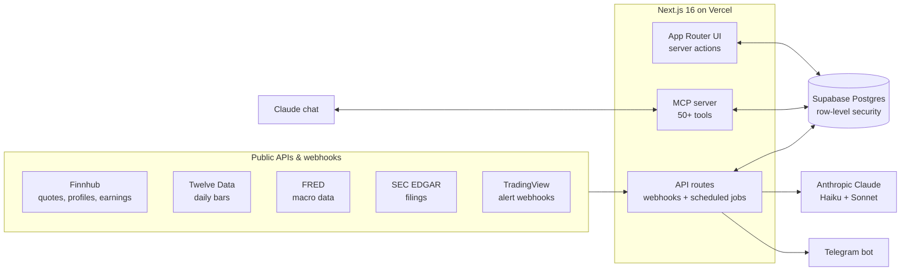
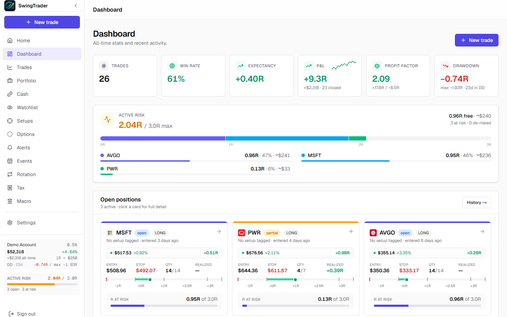
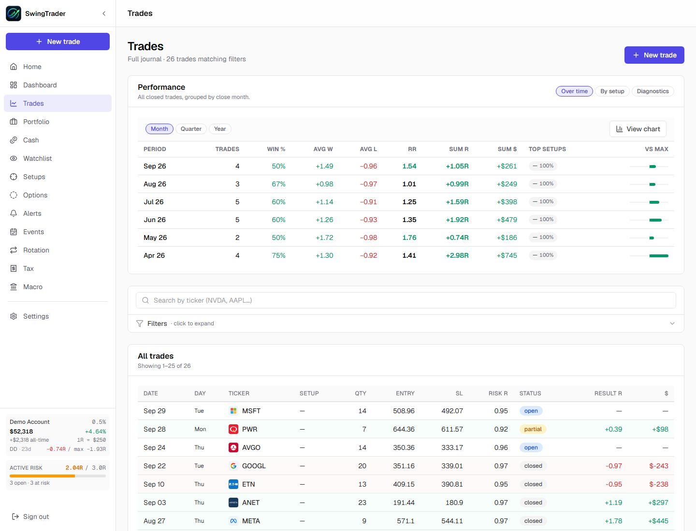
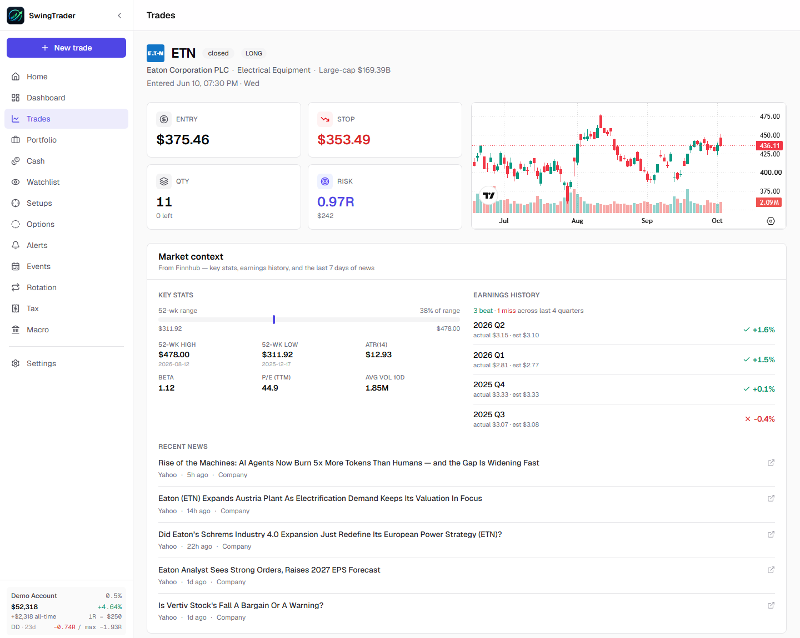
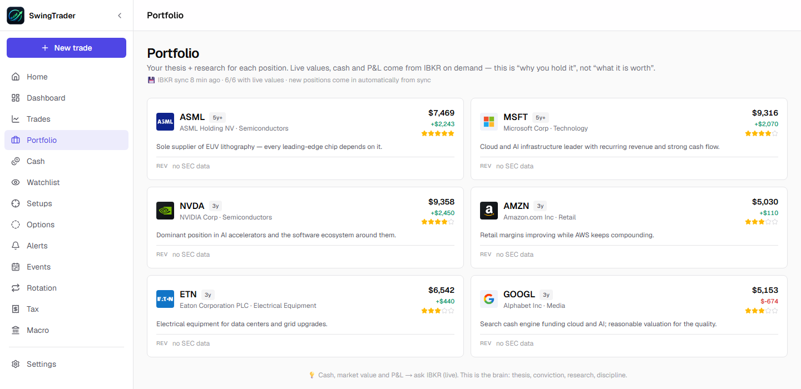
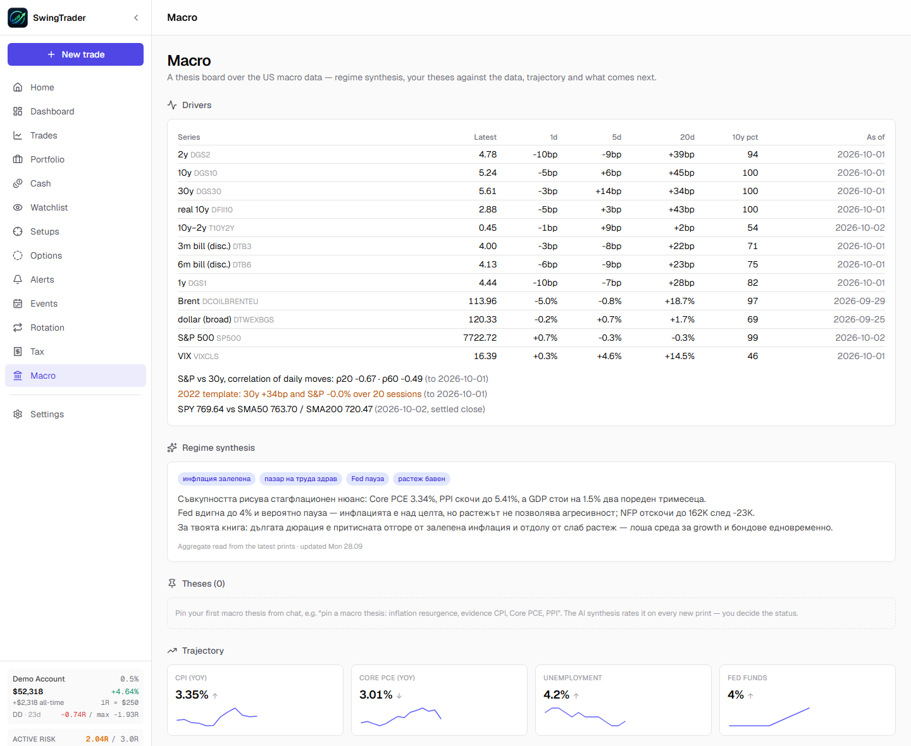
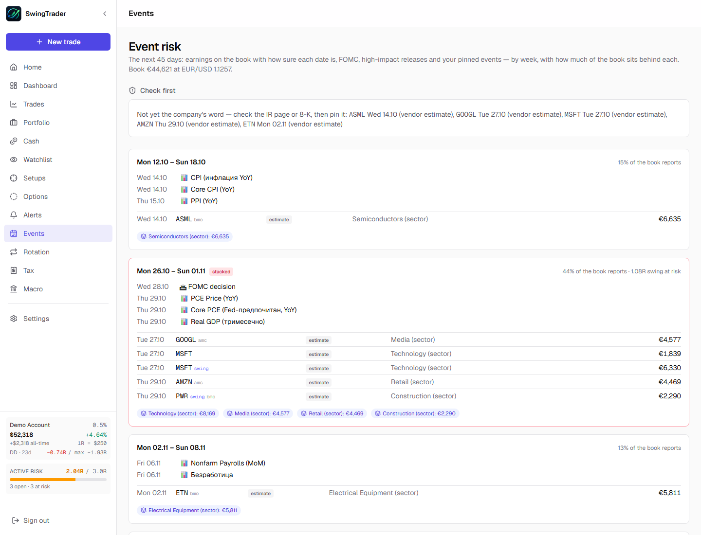
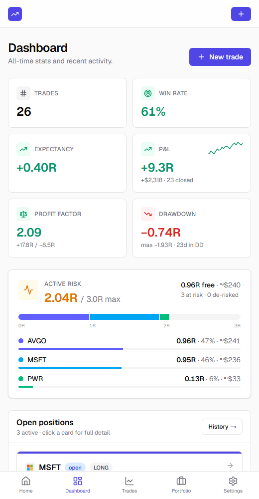

# SwingTrader — trading journal & research assistant

*A personal project, built since April 2026 alongside my full-time job.*

The source code is private because the app holds real financial data. This page describes what the app does, how it is built, and what I learned building it.

---

## Why I built it

I used to track my trades in an Excel sheet. It worked, but it didn't do several things I needed:

- warn me about upcoming earnings;
- check my own rules before an entry;
- keep my research in one place.

There are SaaS tools that each cover part of this. I wanted one tool that fits exactly how I work, so I built it.

## What it does

- **Trade journal**
  - Swing trades with partial entries and exits, fees, risk in R-multiples, and a weekly review.
- **Portfolio**
  - Long-term positions with tax lots and cash per currency.
  - Reconciliation against the broker's positions.
- **Options**
  - Option positions with their own journal.
- **Watchlist & alerts**
  - Price alerts from TradingView webhooks, processed by the app and delivered via a Telegram bot.
- **Research notes**
  - One note per company, with checkpoints such as the next earnings date that remind me to revisit the thesis.
  - Automatic tracking of new SEC filings.
- **Macro dashboard**
  - Interest rates, inflation and credit indicators from FRED, with history and trend.
- **Event-risk map**
  - Upcoming earnings and macro events that affect open positions.
- **AI briefing**
  - A daily briefing and a weekly review generated with Claude from the data in the app.
- **Claude as a co-pilot**
  - An MCP server with 50+ tools lets Claude read and update the journal directly in a conversation.

## How it's built

| Area | Technology |
|---|---|
| Frontend & backend | Next.js 16 (App Router, server actions), TypeScript, Tailwind CSS 4 |
| Database & auth | Supabase: Postgres, row-level security (each user sees only their own data), 50+ SQL migrations |
| Hosting & jobs | Vercel; scheduled jobs for the daily briefing, macro update, position scan, research collection and weekly review |
| Data | Finnhub, Twelve Data, FRED, SEC EDGAR, TradingView webhooks, Interactive Brokers positions, Telegram Bot API |
| AI | Anthropic Claude (Haiku 4.5 for routine summaries, Sonnet for deeper analysis); model output is parsed and checked by tested parsers before it is stored |
| Claude integration | MCP server (`mcp-handler`) with token-based access; every tool input validated with Zod |
| Quality | Vitest unit tests for the logic that handles money: fees, lots, risk, alert processing, data freshness. 300+ commits. |

## What I learned

- **Working with external APIs is mostly about edge cases:**
  - rate limits and caching;
  - stale or unfinished daily bars;
  - the same ticker meaning different companies on different exchanges.
- **A database schema grows with understanding.** More than 50 migrations, each a small and reviewable step. Row-level security is on from day one.
- **Use an LLM where it actually helps.** Summaries, briefings and extracting structure from text, while the numbers are always calculated deterministically in code.
- **Building with Claude Code:**
  - I describe the problem, review the result, test it and debug it. Claude writes much of the code.
  - What stays with me is deciding what to build, spotting when something is wrong, and seeing it through to the end.
- **Building a tool for real daily use is different from a demo.** Every bug shows up the next morning.

## Screenshots

*All screenshots come from a demo account. The trades use real historical prices, but the positions, amounts and results are made up.*

**Dashboard** — all-time stats, active risk against the account's cap, and open positions with their R-ladders.

**Trade journal** — performance by month and the full trade list.

**Trade detail** — entry, stop and risk, with market context from Finnhub (key stats, earnings history, recent news).

**Portfolio** — long-term positions with thesis, conviction and time horizon.

**Macro dashboard** — rates, spreads and indicators from FRED, an AI regime synthesis, and the macro trajectory.

**Event-risk map** — upcoming earnings and macro releases, grouped by week, with how much of the portfolio sits behind each.

**Mobile** — the same app on a phone.

The macro synthesis and some event labels appear in Bulgarian: the app is set up for its users' language.

---

*A personal tool. Not investment advice and not a public service.*

---

### Kurzfassung (Deutsch)

SwingTrader ist mein privates Trading-Journal mit Recherche-Assistent, entwickelt seit April 2026 neben meinem Hauptjob.

**Technik:**
- Next.js 16, TypeScript, Supabase (Postgres mit Row-Level-Security) und Vercel.
- Daten aus mehreren öffentlichen APIs: Finnhub, Twelve Data, FRED, SEC EDGAR und TradingView-Webhooks.
- Benachrichtigungen per Telegram.
- KI-Funktionen mit Anthropic Claude.
- Ein MCP-Server, über den Claude direkt mit dem Journal arbeiten kann.

**Was ich gelernt habe:**
- Wie man mit vielen externen APIs zuverlässig umgeht.
- Wie man ein Datenmodell schrittweise weiterentwickelt.
- Wo KI im Alltag wirklich hilft – und wo Zahlen besser fest im Code berechnet werden.

Der Quellcode ist privat, weil die App echte Finanzdaten enthält.
